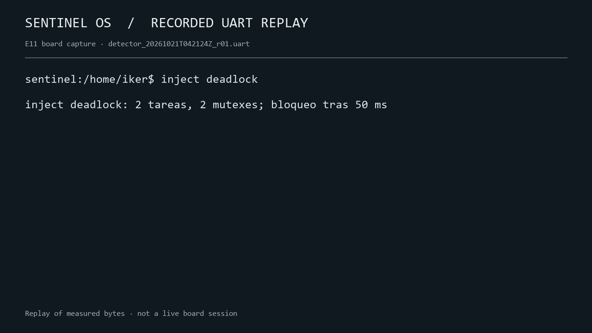

# Sentinel OS

**A small bare-metal operating system for ESP32 that measures the cost of observing itself.** / **Un sistema operativo bare-metal para ESP32 que mide cuánto cuesta observarse.**

  



*Recorded UART replay from an actual E11 board run, not a live shell capture. The complete raw recording is [`detector_20261021T042124Z_r01.uart`](experiments/e11/detector_20261021T042124Z_r01.uart).*

## What it does / Qué hace

- Boots on an ESP32-WROOM-32 without FreeRTOS; schedules tasks with fixed priorities and round robin within each priority.
- Provides a heap, mutexes, a RAM file system and a shell with `ls`, `cd`, `pwd`, `ps`, `free` and fault injection commands.
- Records kernel events in a bounded ring buffer, frames them over UART and decodes them on a PC.
- Detects wait-for cycles (deadlocks) and reports its own measurement overhead.

## Architecture / Arquitectura

```text
ESP32 core 0: shell + tasks + scheduler + heap + RAMFS
             ↓ probes and CCOUNT timestamps
             ring buffer → framed UART with sequence and CRC
             ↓
Windows PC:  bridge.py → console / SQLite / CSV analysis / raw replay
```

Core 1 monitoring is a proposed [future stage](docs/00-MASTER.md), not part of these results. See the [architecture](docs/01-ARQUITECTURA.md), [protocol](docs/03-PROTOCOLO.md) and [ADRs](docs/04-DECISIONES-ADR.md).

## Measured results / Resultados medidos

The numbers below come from the [E11 master table](experiments/e11/master_results.csv). Unless noted, `±` is the standard deviation across independent runs; it is **not** a confidence interval.

| Measurement on ESP32 | Result | Target | Verdict |
|---|---:|---:|---|
| Observed context switch, nominal load, TRACE ON, 57,940 switches | 22.355 ± 0.223 µs | <10 µs | **Missed** |
| TRACE CPU cost, nominal load, 5 ON + 5 OFF runs | +1.285 ± 0.009 percentage points | <5 points | Met |
| Integral trace cost, including drain | 109.111 ± 0.849 cycles/event | — | Measured |
| Static RAM / firmware size added by TRACE | +33,320 B / +3,296 B | — | One image per variant |
| Deadlock detection | 20/20; 320.862 ± 158.026 ms | 100%; <1 s | Met in tested cases |
| False deadlock alerts, continuous nominal load | 0 in 3,608.872 s | 0 in 1 h | Met in one hour |
| Device-reported dropped events, nominal | 0 of 49,314 emitted | <1% | Met |

The switch value includes the measurement probe and excludes the final interrupt-return instructions. The UART hour contained 14 CRC errors and 901 sequence gaps on Windows even though the board reported zero buffer drops; those are different loss points. A GPIO/oscilloscope comparison was unavailable. The [technical report](docs/e12/informe-tecnico.md) explains the methods, uncertainty and limits.

## Run and reproduce / Ejecutar y reproducir

Prerequisites: ESP32-WROOM-32, USB serial adapter/board, WSL with the Xtensa ESP32 toolchain and `esptool.py`; Python 3.9+ on Windows, with `pyserial` only for live serial use. The exact port must be checked each time. Flashing changes the board firmware.

```bash
# WSL, from the repository root: build the current instrumented firmware
make TRACE=1 TRANSPORT=1
# Replace /dev/ttyUSB0 after checking the device
make TRACE=1 TRANSPORT=1 flash PORT=/dev/ttyUSB0
make test
```

```powershell
# Windows PowerShell: inspect the connected port, then read live telemetry
py -m serial.tools.list_ports -v
py tools/bridge.py --port COM8 --baud 921600 --sink console
```

`COM8` was the port used during E11; it may differ now. To inspect recorded evidence without a board:

```powershell
py tools/bridge.py --replay experiments/e11/detector_20261021T042124Z_r01.uart --sink console
py tools/testbench/audit_e11.py
```

The first command replays real bytes, including `inject deadlock` and its alert. The audit should report `PASS`, six stories evaluated, 115 versioned evidence files and S1 unmet. For the full experimental method and raw runs, see [`experiments/e11/README.md`](experiments/e11/README.md).

## Decisions and learning / Decisiones y aprendizajes

The [ADRs](docs/04-DECISIONES-ADR.md) record why the kernel uses RAMFS, why the network lives on the PC, why the detector takes no mutex and why missing heartbeat frames matter. A subtle Xtensa context-switch issue was the register-window spill: preserving the right stack and register state mattered more than making the first boot appear successful. E11 also showed why a measured claim must name its load and instrumentation: the CPU overhead target passed, while the switch-latency target failed.

## Known limits and next work / Límites y trabajo futuro

No virtual memory or process isolation; RAMFS does not persist after reboot; no priority inheritance; the measured implementation runs on core 0. UART reception had CRC and gap errors. The external Windows timer checks scale but cannot establish the requested GPIO–CCOUNT difference below 5%. Future work is designed in E13–E19: a second-core observer, cloud export, dashboard, CI and persistent storage. These are not implemented in the measured build.

**Demo video:** local script and recorded assets are in [`docs/e12/video`](docs/e12/video/README.md); an uploaded YouTube link will be added after Iker reviews and publishes an actual video. **License:** no license has been selected; reuse terms are not implied by the public repository.

The professor's [formal nine-criterion rubric](docs/09-RUBRICA-PROFESOR.md) has a separate video of up to 10 minutes and additional features planned in E20–E23. This portfolio demo does not claim to satisfy that graded submission.
