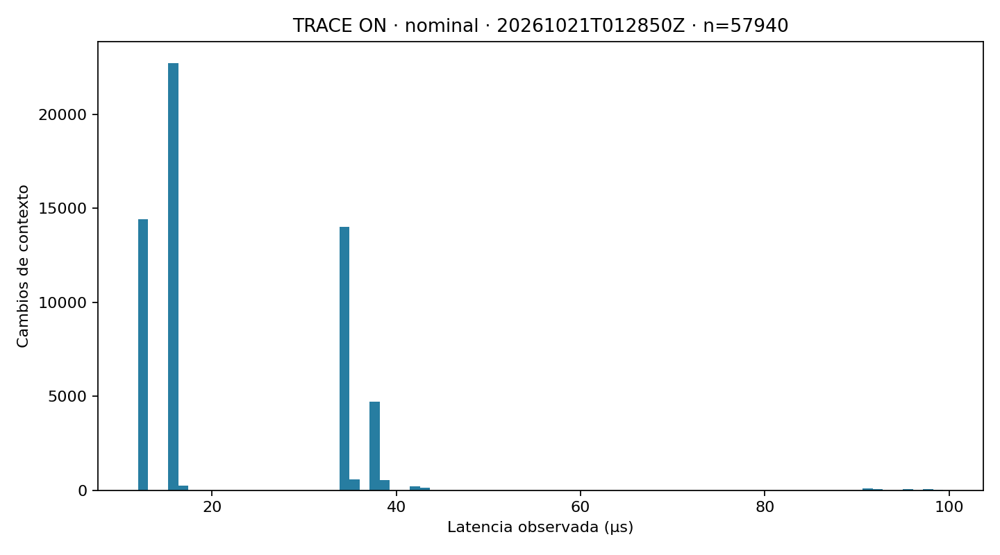
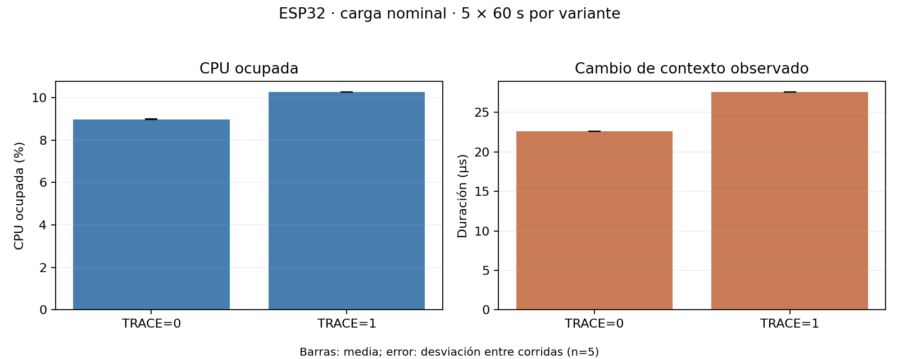

<div align="center">


# Sentinel OS

### Un sistema operativo bare-metal para ESP32 que mide el costo de observarse a sí mismo

**Desarrollo de un sistema operativo experimental para ESP32**
<br>
Kernel propio · Planificación de tareas · Gestión de memoria · Instrumentación · Telemetría

<br>


<br>

[Descripción](#1-descripción-del-proyecto) ·
[Arquitectura](#3-arquitectura-del-sistema) ·
[Resultados](#7-resultados-experimentales) ·
[Primeros pasos](#8-primeros-pasos) ·
[Documentación](#15-documentación-adicional)

</div>

---

## Resumen

**Sentinel OS** es un kernel experimental escrito en C que se ejecuta directamente sobre el ESP32-WROOM-32, sin FreeRTOS. Además de implementar los componentes clásicos de un sistema operativo, **cuantifica experimentalmente cuánto cuesta observar su propio comportamiento** mediante instrumentación con contador de ciclos CCOUNT y telemetría binaria por UART.

| | |
|---|---|
| **Qué es** | Kernel bare-metal con scheduler, heap, mutexes, detector de deadlocks, VFS en RAM y shell. |
| **Qué lo distingue** | Instrumentación compilable (TRACE ON/OFF) y medición del costo de la observabilidad. |
| **Cómo se observa** | Protocolo binario por UART con CRC16 hacia un puente Python y un dashboard local. |
| **Estado** | Experimental. Resultados medidos en hardware con limitaciones documentadas (ver [sección 7](#7-resultados-experimentales) y [sección 13](#13-limitaciones-conocidas)). |

### Inicio rápido

No necesitas la placa para explorar el proyecto. Desde la raíz del repositorio:

```bash
# Ejecutar las pruebas en el computador (host tests)
make test

# Reproducir una captura UART real del detector de deadlocks
python3 tools/bridge.py --replay experiments/e11/detector_20261021T042124Z_r01.uart --sink console
```

Para compilar, flashear y ejecutar sobre el ESP32 consulta [Primeros pasos](#8-primeros-pasos).

---

## Contenido

1. [Descripción del proyecto](#1-descripción-del-proyecto)
2. [Características principales](#2-características-principales)
3. [Arquitectura del sistema](#3-arquitectura-del-sistema)
4. [Sistema de instrumentación y observabilidad](#4-sistema-de-instrumentación-y-observabilidad)
5. [Protocolo de comunicación UART](#5-protocolo-de-comunicación-uart)
6. [Herramientas externas](#6-herramientas-externas)
7. [Resultados experimentales](#7-resultados-experimentales)
8. [Primeros pasos](#8-primeros-pasos)
9. [Pruebas y validación](#9-pruebas-y-validación)
10. [Estructura del repositorio](#10-estructura-del-repositorio)
11. [Tecnologías y herramientas](#11-tecnologías-y-herramientas)
12. [Decisiones de diseño](#12-decisiones-de-diseño)
13. [Limitaciones conocidas](#13-limitaciones-conocidas)
14. [Roadmap y trabajo futuro](#14-roadmap-y-trabajo-futuro)
15. [Documentación adicional](#15-documentación-adicional)
16. [Demo y material audiovisual](#16-demo-y-material-audiovisual)
17. [Contexto académico](#17-contexto-académico)
18. [Autor](#18-autor)

---

## 1. Descripción del proyecto

**Sentinel OS** es un sistema operativo experimental desarrollado en lenguaje C para el microcontrolador ESP32-WROOM-32. Su propósito es implementar y estudiar los componentes fundamentales de un sistema operativo desde una arquitectura bare-metal, sin depender de FreeRTOS ni de otro kernel externo.

El proyecto busca comprender cómo funciona un sistema operativo desde sus niveles más bajos: inicialización del hardware, administración de memoria, planificación de procesos, sincronización entre tareas, manejo de interrupciones y comunicación entre componentes.

Sin embargo, Sentinel OS tiene un objetivo adicional que lo diferencia de una implementación convencional: **medir y analizar el costo computacional que introduce la instrumentación utilizada para observar el comportamiento interno del propio sistema operativo.**

Para ello, incorpora mecanismos de trazabilidad que registran eventos del kernel, miden ciclos de CPU mediante el contador CCOUNT del procesador Xtensa y transmiten información hacia un computador mediante un protocolo binario implementado sobre UART.

El computador funciona como una estación externa de observabilidad, encargada de recibir, interpretar, almacenar y visualizar los datos sin incorporar una pila de red al kernel del ESP32.

El proyecto también implementa un detector de interbloqueos (*deadlocks*) basado en grafos de espera, permitiendo identificar ciclos de dependencia entre tareas y recursos de sincronización.

### Objetivos principales

- Construir un kernel independiente que se ejecute directamente sobre el hardware ESP32.
- Implementar planificación de tareas con prioridades y Round Robin.
- Desarrollar mecanismos propios de administración dinámica de memoria.
- Incorporar sincronización mediante mutexes y análisis de dependencias.
- Implementar un sistema de archivos virtual en memoria RAM.
- Desarrollar una shell para interactuar con el kernel.
- Crear un sistema de instrumentación de bajo impacto.
- Diseñar un protocolo binario de telemetría sobre UART.
- Desarrollar herramientas externas para analizar el comportamiento del sistema.
- Evaluar experimentalmente el rendimiento y el costo de la observabilidad.

---

## 2. Características principales

| Componente | Descripción |
|---|---|
| Kernel bare-metal | Ejecución directa sobre ESP32 sin FreeRTOS. |
| Scheduler | Planificación por prioridades con Round Robin. |
| Gestión de memoria | Heap dinámico con First Fit, división y coalescencia de bloques. |
| Sincronización | Mutexes y administración de dependencias entre tareas. |
| Deadlock Detector | Detección de ciclos en grafos de espera. |
| RAMFS / VFS | Sistema de archivos virtual almacenado en memoria RAM. |
| Shell | Interfaz interactiva para consultar y controlar el kernel. |
| Instrumentación | Registro de eventos y medición de ciclos de CPU. |
| Telemetría | Comunicación binaria mediante UART con secuenciación y CRC16. |
| Herramientas externas | Puente Python, reproducción de capturas y dashboard local. |
| Testbench | Pruebas funcionales y experimentales sobre hardware y host. |

---

## 3. Arquitectura del sistema

Sentinel OS está organizado en dos grandes entornos:

1. **ESP32:** ejecuta el kernel, administra los recursos del hardware y genera los eventos de instrumentación.
2. **Computador externo:** recibe la telemetría, interpreta los eventos y permite analizar el comportamiento del sistema.

La separación permite mantener el kernel independiente de servicios de red y reducir la interferencia de las herramientas de observabilidad.

### Arquitectura general

```text
                 SENTINEL OS
              ESP32-WROOM-32
             Xtensa LX6 / Core 0
                       |
       +---------------+----------------+
       |               |                |
   KERNEL          MEMORY           DRIVERS
       |               |                |
   Scheduler         Heap          UART / GPIO
   Task Manager      RAMFS
   Synchronization   VFS
   Deadlock
   Detection
       |
       +---------------+
                       |
               INSTRUMENTATION
                       |
                CCOUNT / Probes
                       |
                Ring Buffer
                       |
                UART Transport
                       |
                Binary Frames
                       |
                 USB / Serial
                       |
             +---------+---------+
             |                   |
         Python Bridge       Dashboard
             |                   |
         Event Decoder       Monitoring
             |                   |
         CSV / SQLite       Visualization
             |
         Analysis Tools
             |
       Experimental Results
```

**Importante:** la arquitectura experimental medida actualmente ejecuta el kernel en el núcleo 0. La implementación de un observador independiente en el núcleo 1 corresponde a una etapa futura y no debe interpretarse como una funcionalidad disponible en los resultados actuales.

### 3.1. Kernel

El kernel es el núcleo central de Sentinel OS. Se encarga de administrar los recursos del sistema y coordinar la ejecución de las tareas.

Entre sus responsabilidades están:

- Inicialización del sistema.
- Gestión de interrupciones.
- Administración de tareas.
- Planificación de CPU.
- Sincronización.
- Administración de memoria.
- Manejo de excepciones y errores.
- Integración de mecanismos de instrumentación.

El punto de entrada principal se encuentra en:

`kernel/core/kmain.c`

### 3.2. Planificador de tareas

Sentinel implementa un planificador basado en prioridades estáticas y Round Robin dentro de cada nivel de prioridad.

El sistema dispone de ocho niveles de prioridad:

- Prioridad 0: máxima prioridad.
- Prioridad 7: prioridad mínima, utilizada por la tarea idle.

El planificador selecciona siempre la tarea lista con mayor prioridad. Cuando existen varias tareas con la misma prioridad, distribuye el tiempo de CPU mediante un quantum configurable.

El quantum predeterminado es de 10 ms.

El sistema contempla diferentes estados de ejecución:

- READY
- RUNNING
- BLOCKED
- SLEEPING
- SUSPENDED
- TERMINATED

La administración de tareas permite observar cambios de contexto, tiempos de espera y utilización de CPU.

Archivos principales:

- `kernel/core/sched.c`
- `kernel/core/sched.h`
- `kernel/core/task.c`
- `kernel/include/sentinel/task.h`

### 3.3. Gestión de memoria

Sentinel cuenta con un administrador de memoria dinámica propio mediante un heap administrado por el kernel.

La implementación utiliza una estrategia First Fit para encontrar bloques disponibles.

Entre sus funcionalidades se encuentran:

- Asignación dinámica mediante `kmalloc`.
- Liberación de memoria mediante `kfree`.
- División de bloques disponibles.
- Coalescencia de bloques libres adyacentes.
- Detección de corrupción mediante magic values y canarios.
- Seguimiento de asignaciones y liberaciones.
- Identificación de dobles liberaciones.
- Medición de fragmentación de memoria.

El administrador mantiene estadísticas como:

- Memoria total.
- Memoria utilizada.
- Memoria disponible.
- Tamaño del mayor bloque libre.
- Cantidad de bloques.
- Pico máximo de utilización.
- Número de asignaciones y liberaciones.
- Contadores de errores.

También permite estudiar situaciones de fuga y fragmentación controlada.

Archivo principal:

`kernel/mm/heap.c`

### 3.4. Sincronización y detección de deadlocks

El kernel implementa mecanismos de sincronización para controlar el acceso concurrente a recursos compartidos.

El detector de deadlocks utiliza un grafo de espera (*Wait-For Graph*) para representar las relaciones entre tareas y mutexes.

Cuando una tarea espera por un recurso, se establece una dependencia respecto a la tarea propietaria.

El detector analiza estas dependencias para identificar ciclos que representan posibles interbloqueos.

La implementación contempla:

- Identificación de tareas bloqueadas.
- Registro de recursos solicitados.
- Seguimiento de propietarios de mutexes.
- Construcción del grafo de dependencias.
- Detección de ciclos.
- Generación de alertas.
- Pruebas mediante inyección controlada de deadlocks.

Esta funcionalidad permite demostrar problemas de sincronización y estudiar su comportamiento de forma reproducible.

Archivos principales:

- `kernel/core/sync.c`
- `kernel/core/graph.c`
- `kernel/core/detector.c`
- `kernel/include/sentinel/detector.h`

### 3.5. Sistema de archivos virtual

Sentinel incorpora una implementación de VFS (*Virtual File System*) con almacenamiento RAMFS.

El sistema permite organizar información mediante directorios y archivos sin depender de un sistema de almacenamiento persistente.

Entre sus funcionalidades se encuentran:

- Resolución de rutas.
- Árbol de directorios.
- Directorio de trabajo.
- Creación y administración de entradas.
- Acceso a información del sistema mediante interfaces virtuales.

Al estar almacenado en RAM, su contenido no persiste después de reiniciar el dispositivo.

Archivos principales:

- `kernel/fs/vfs.c`
- `kernel/fs/procfs.c`
- `kernel/include/sentinel/vfs.h`

### 3.6. Shell interactiva

El proyecto dispone de una shell que permite interactuar con el kernel mediante comandos enviados por UART.

La shell facilita la inspección del estado del sistema, la consulta de recursos y la ejecución de escenarios experimentales.

Entre los comandos documentados se encuentran:

| Comando | Función |
|---|---|
| `ls` | Lista el contenido del directorio actual. |
| `cd` | Cambia el directorio de trabajo. |
| `pwd` | Muestra la ruta actual. |
| `ps` | Consulta las tareas del sistema. |
| `free` | Muestra estadísticas de memoria. |

También existen comandos de diagnóstico, instrumentación e inyección de fallos, como los utilizados para probar deadlocks.

La disponibilidad de comandos adicionales depende de la configuración y versión del firmware.

Archivos principales:

- `kernel/shell/shell.c`
- `kernel/shell/cmds.c`
- `kernel/shell/inject_cmd.c`
- `kernel/shell/trace_cmd.c`

---

## 4. Sistema de instrumentación y observabilidad

Uno de los principales aportes técnicos de Sentinel OS es su sistema de instrumentación.

El objetivo es observar el comportamiento interno del kernel sin introducir una interferencia excesiva en las operaciones que se están midiendo.

Para ello se utilizan sondas (*probes*) que registran eventos relevantes durante la ejecución.

### 4.1. Registro de eventos

La instrumentación permite registrar información relacionada con:

- Cambios de contexto.
- Creación y finalización de tareas.
- Asignaciones y liberaciones de memoria.
- Operaciones de sincronización.
- Bloqueos y desbloqueos.
- Eventos de heartbeat.
- Alertas del sistema.
- Inyección de fallos.

Cada evento contiene información temporal obtenida mediante el contador de ciclos CCOUNT del procesador Xtensa.

### 4.2. Ring Buffer

Los eventos se almacenan inicialmente en un buffer circular de capacidad limitada.

La decisión de diseño busca evitar que la instrumentación bloquee las operaciones del kernel.

Sus principios son:

- Las sondas no deben adquirir mutexes.
- El registro de eventos debe ser acotado.
- Los eventos no se retransmiten.
- Los eventos descartados deben contabilizarse.
- La instrumentación debe poder deshabilitarse mediante compilación.

Este diseño prioriza la continuidad de ejecución frente a la conservación de cada evento individual.

### 4.3. Medición del costo de observabilidad

Sentinel permite comparar dos variantes de compilación:

- TRACE ON: instrumentación habilitada.
- TRACE OFF: instrumentación deshabilitada.

La comparación permite estudiar:

- Consumo adicional de CPU.
- Uso de memoria estática.
- Tamaño adicional del firmware.
- Costo de generación y drenaje de eventos.
- Latencia observada durante los cambios de contexto.

El propósito no es asumir que medir no tiene costo, sino cuantificar ese costo experimentalmente.

---

## 5. Protocolo de comunicación UART

El ESP32 transmite información hacia un computador mediante UART.

Sobre este enlace se implementa un protocolo binario propio que permite transportar eventos, estadísticas, registros y alertas.

La decisión de utilizar UART responde a la necesidad de mantener el kernel independiente de una pila de red.

### 5.1. Estructura de las tramas

La versión 1 del protocolo utiliza la siguiente estructura:

| Campo | Tamaño | Descripción |
|---|---:|---|
| SYNC | 2 bytes | Sincronización `0xAA 0x55`. |
| VER | 1 byte | Versión del protocolo. |
| TYPE | 1 byte | Tipo de trama. |
| SEQ | 2 bytes | Número secuencial. |
| LEN | 2 bytes | Longitud del contenido. |
| PAYLOAD | Variable | Datos transmitidos. |
| CRC16 | 2 bytes | Verificación de integridad. |

El protocolo utiliza CRC-16/CCITT-FALSE para detectar errores de transmisión.

La secuencia permite identificar saltos entre tramas y estimar pérdidas durante la recepción.

### 5.2. Tipos de mensajes

El protocolo contempla diferentes tipos de tramas:

| Tipo | Identificador | Descripción |
|---|---|---|
| FRAME_EVENTS | `0x01` | Eventos de instrumentación. |
| FRAME_STATS | `0x02` | Estadísticas generales. |
| FRAME_LOG | `0x03` | Mensajes y registros. |
| FRAME_ALERT | `0x04` | Alertas generadas por el kernel. |
| FRAME_HELLO | `0x05` | Identificación del dispositivo. |
| FRAME_HEARTBEAT | `0x06` | Señal periódica de actividad. |
| FRAME_TASKS | `0x07` | Información de las tareas. |
| FRAME_CMD | `0x81` | Comandos enviados al dispositivo. |
| FRAME_TRACE_CFG | `0x82` | Configuración de instrumentación. |
| FRAME_ACK | `0x83` | Confirmaciones. |

La especificación completa se encuentra en:

[`docs/03-PROTOCOLO.md`](docs/03-PROTOCOLO.md)

---

## 6. Herramientas externas

El computador cumple el papel de estación de observabilidad. Recibe las tramas generadas por el ESP32 y las transforma en información útil para analizar el comportamiento del kernel.

### 6.1. Python Bridge

El puente desarrollado en Python se encarga de:

- Establecer la comunicación serial.
- Leer las tramas recibidas.
- Validar la integridad mediante CRC.
- Interpretar los mensajes.
- Detectar discontinuidades de secuencia.
- Procesar eventos y estadísticas.
- Reproducir capturas UART previamente registradas.
- Enviar información hacia diferentes destinos de salida.

Archivo principal:

`tools/bridge.py`

### 6.2. Dashboard de monitorización

El proyecto incluye una interfaz local de monitorización que permite visualizar información recibida desde el dispositivo.

Archivo:

`tools/dashboard.html`

El dashboard forma parte de las herramientas externas y no se ejecuta dentro del microcontrolador.

### 6.3. Análisis experimental

Sentinel incluye un conjunto de herramientas para procesar las capturas y generar resultados cuantitativos.

Entre ellas:

- Análisis de cambios de contexto.
- Evaluación del consumo de instrumentación.
- Medición de fragmentación de memoria.
- Detección de fugas controladas.
- Análisis de falsas alertas.
- Evaluación del detector de deadlocks.
- Auditoría de evidencias experimentales.

Directorio:

`tools/testbench/`

---

## 7. Resultados experimentales

Una parte fundamental del desarrollo de Sentinel OS consiste en validar las decisiones de diseño mediante experimentos reproducibles.

Los resultados siguientes corresponden a la batería experimental E11 realizada sobre hardware ESP32.

No representan resultados teóricos ni objetivos de diseño: son mediciones obtenidas bajo las condiciones documentadas en el repositorio.

### 7.1. Resultados principales

| Métrica | Resultado obtenido | Objetivo | Evaluación |
|---|---:|---:|---|
| Latencia observada de cambio de contexto | 22.355 ± 0.223 µs | <10 µs | No cumplido |
| Costo de TRACE en CPU | +1.285 ± 0.009 puntos porcentuales | <5 puntos | Cumplido |
| Costo integral de traza | 109.111 ± 0.849 ciclos/evento | Medición | Medido |
| Detección de deadlocks | 20/20 | 100 % | Cumplido en los casos probados |
| Tiempo promedio de detección | 320.862 ± 158.026 ms | <1 s | Cumplido |
| Falsas alertas | 0 durante 3,608.9 segundos | 0 en 1 hora | Cumplido en la prueba |
| Eventos descartados en placa | 0 de 49,314 | <1 % | Cumplido |
| Memoria estática adicional de TRACE | 33,320 bytes | Medición | Medido |
| Tamaño adicional del firmware | 3,296 bytes | Medición | Medido |

**Interpretación:** el objetivo de reducir la latencia observada de cambio de contexto por debajo de 10 µs no se alcanzó. La medición obtenida fue de aproximadamente 22.355 µs.

Por otro lado, el costo adicional de CPU producido por TRACE fue inferior al límite establecido.

En las pruebas del detector, se identificaron correctamente los 20 deadlocks inyectados. También se registraron cero falsas alertas durante una prueba continua de aproximadamente una hora.

### 7.2. Limitaciones de las mediciones

Es importante diferenciar entre los eventos descartados por el dispositivo y los problemas de recepción en el computador.

Durante una prueba nominal de telemetría:

- El ESP32 reportó cero eventos descartados en su buffer.
- El receptor de Windows registró 14 errores CRC.
- Se identificaron 901 discontinuidades de secuencia.

Estos resultados representan diferentes puntos de pérdida y no deben interpretarse como equivalentes.

Además, no se pudo realizar una comparación GPIO-osciloscopio para validar la diferencia entre el tiempo medido mediante CCOUNT y una referencia física externa.

Por esta razón, los resultados deben interpretarse dentro de las condiciones y limitaciones de cada experimento.

### 7.3. Gráficas

**Distribución de la latencia observada de cambio de contexto** (TRACE ON, carga nominal, 57 940 cambios de contexto en cinco corridas de 30 s). La media de las medias por corrida es 22.355 µs; la distribución es multimodal, por lo que la media por sí sola no la describe por completo.

<p align="center">
  
</p>

**Costo de TRACE en CPU bajo carga nominal** (5 × 60 s por variante). El panel izquierdo respalda el costo de +1.285 puntos porcentuales de CPU reportado arriba.

<p align="center">
  
</p>

> **Nota de lectura:** el panel derecho de esta segunda figura proviene de una ventana de medición distinta a la del histograma. Sus valores no sustituyen la latencia de 22.355 µs de la batería de cambio de contexto ni deben combinarse con ella. El criterio de cada medición está en [`experiments/e11/README.md`](experiments/e11/README.md).

### 7.4. Evidencias

Los datos experimentales se encuentran disponibles en:

- [`experiments/e11/`](experiments/e11/)
- [`experiments/e11/master_results.csv`](experiments/e11/master_results.csv)
- [`experiments/e11/master_results.md`](experiments/e11/master_results.md)
- [`experiments/e11/README.md`](experiments/e11/README.md)
- [`docs/e12/informe-tecnico.md`](docs/e12/informe-tecnico.md)

La evidencia incluye capturas UART, archivos CSV, resúmenes estadísticos, gráficas y scripts de análisis.

---

## 8. Primeros pasos

### 8.1. Requisitos

Para trabajar con Sentinel OS se necesita:

**Hardware**
- ESP32-WROOM-32.
- Cable USB compatible con la placa.
- Computador con Windows y/o Linux.

**Software**
- WSL con una distribución Linux.
- Xtensa ESP32 Toolchain.
- GNU Make.
- GCC.
- Python 3.9 o superior.
- esptool.py.
- PySerial para comunicación serial en vivo desde Python.

El proyecto utiliza una compilación bare-metal mediante la herramienta `xtensa-esp32-elf-gcc`.

### 8.2. Clonar el repositorio

```bash
git clone https://github.com/Ikeracevedo/sentinel-os.git

cd sentinel-os
```

### 8.3. Verificar las herramientas

```bash
xtensa-esp32-elf-gcc --version

make --version

python3 --version

esptool.py version
```

En Windows también puedes comprobar la disponibilidad de Python:

```powershell
py --version
```

### 8.4. Compilar el kernel

Para compilar el firmware con instrumentación habilitada:

```bash
make TRACE=1
```

Para compilar una variante sin instrumentación:

```bash
make TRACE=0
```

Para compilar el firmware con el transporte UART:

```bash
make TRACE=1 TRANSPORT=1
```

La opción `TRANSPORT=1` requiere `TRACE=1`.

### 8.5. Consultar el tamaño del firmware

```bash
make size
```

Este comando permite consultar información sobre el tamaño del binario generado.

### 8.6. Flashear el ESP32

El firmware compilado puede cargarse directamente en la memoria flash del ESP32.

Primero verifica el puerto serial disponible.

En Windows:

```powershell
py -m serial.tools.list_ports -v
```

En Linux:

```bash
ls /dev/ttyUSB*
```

Después puedes cargar la imagen de transporte desde WSL:

```bash
make TRACE=1 TRANSPORT=1 flash PORT=/dev/ttyUSB0
```

Reemplaza el puerto por el correspondiente a tu dispositivo.

**Advertencia:** flashear el dispositivo reemplaza el firmware que se encuentra actualmente en la placa. Verifica el puerto antes de ejecutar el comando.

### 8.7. Ejecutar Sentinel OS

El repositorio incluye lanzadores para facilitar la ejecución desde Windows y Linux.

#### Windows PowerShell

Desde la raíz del proyecto:

```powershell
.\sentinel.ps1 -Port COM8
```

El lanzador inicia el entorno de ejecución, el puente UART y el dashboard local.

El dashboard se encuentra disponible en:

```text
http://127.0.0.1:8080
```

Para finalizar correctamente la ejecución:

```text
Ctrl + C
```

#### Linux / WSL

```bash
./sentinel --port /dev/ttyUSB0
```

También existe un lanzador de compatibilidad:

```bash
./minios --port /dev/ttyUSB0
```

#### Comunicación directa mediante Python

Si se desea ejecutar el puente de forma independiente:

```powershell
py tools/bridge.py --port COM8 --baud 921600 --sink console
```

El puerto `COM8` corresponde a una configuración utilizada durante los experimentos y puede variar según el computador.

---

## 9. Pruebas y validación

Sentinel OS cuenta con pruebas destinadas a validar diferentes componentes del kernel y de las herramientas externas.

Las pruebas se dividen entre:

- Pruebas ejecutadas en el computador (*host tests*).
- Pruebas de integración.
- Pruebas que requieren hardware ESP32.
- Pruebas experimentales de rendimiento.
- Reproducción y auditoría de capturas UART.

### Ejecutar pruebas disponibles

Desde WSL, en la raíz del repositorio:

```bash
make test
```

Este comando compila y ejecuta las pruebas configuradas en el Makefile.

Entre los componentes evaluados se encuentran:

| Componente | Validación |
|---|---|
| Heap | Asignación, liberación y administración de bloques. |
| VFS | Resolución y administración del sistema de archivos. |
| Ring Buffer | Registro y recuperación de eventos. |
| Frames | Construcción y validación de tramas. |
| Graph | Análisis de grafos y dependencias. |
| Alerts | Gestión de alertas. |
| Bridge | Procesamiento de comunicación serial. |
| Parser | Interpretación de comandos. |

### Reproducir una captura experimental

Una de las ventajas del proyecto es que permite estudiar evidencias previamente capturadas sin tener conectado el ESP32.

En Windows:

```powershell
py tools/bridge.py --replay experiments/e11/detector_20261021T042124Z_r01.uart --sink console
```

Este comando reproduce una captura UART real utilizada durante las pruebas del detector de deadlocks.

### Auditar los resultados experimentales

```powershell
py tools/testbench/audit_e11.py
```

La auditoría verifica la consistencia del conjunto de evidencias E11 y sus criterios de evaluación.

---

## 10. Estructura del repositorio

La organización del proyecto separa el código del kernel, las herramientas externas, las pruebas, la documentación y las evidencias experimentales.

```text
sentinel-os/
├── assets/                  # Logos e imágenes del README
│   ├── upb-logo.png
│   ├── sentinel-os-logo.png
│   └── sentinel-os-logo-v2.png
│
├── docs/                    # Documentación técnica y entregables
│   ├── 00-MASTER.md
│   ├── 01-ARQUITECTURA.md
│   ├── 03-PROTOCOLO.md
│   ├── 04-DECISIONES-ADR.md
│   ├── 05-ESTADO.md
│   ├── 08-REQUISITOS-PROFESOR.md
│   ├── 09-RUBRICA-PROFESOR.md
│   ├── 10-PLAN-MVP-REUNION.md
│   ├── e12/                 # Informe técnico, preguntas, video y entregables
│   └── tasks/               # Historias de usuario por etapa
│
├── experiments/
│   └── e11/                 # Capturas UART, CSV, gráficas y resultados maestros
│
├── kernel/
│   ├── arch/xtensa/         # Arranque, vectores, contexto e interrupciones
│   ├── core/                # kmain, scheduler, tareas, sync, deadlocks, trace,
│   │                        # transporte UART, tramas y alertas
│   ├── drivers/             # GPIO y UART
│   ├── fs/                  # VFS y procfs
│   ├── include/sentinel/    # Cabeceras públicas del kernel
│   ├── lib/                 # kprintf y operaciones de memoria
│   ├── mm/                  # Heap (First Fit)
│   └── shell/               # Shell, comandos e inyección de fallos
│
├── tests/                   # Pruebas en host (test_*.c) y en placa (*_board.*)
│
├── tools/
│   ├── bridge.py            # Puente UART / reproducción de capturas
│   ├── capture.py
│   ├── dashboard.html       # Dashboard local
│   ├── run_board.sh
│   ├── shell_test.py
│   ├── e10_*_board.py       # Escenarios sobre placa
│   ├── e12/                 # Generación de entregables
│   └── testbench/           # Baterías experimentales y análisis
│
├── Makefile
├── linker.ld
├── sentinel / sentinel.ps1  # Lanzadores (Linux/WSL y Windows)
├── minios / minios.ps1      # Lanzadores de compatibilidad
└── README.md
```

---

## 11. Tecnologías y herramientas

### Hardware

- ESP32-WROOM-32.
- Arquitectura Xtensa LX6.
- Interfaz serial UART.
- USB para comunicación con el computador.

### Desarrollo del kernel

- C.
- Assembly Xtensa.
- GNU Make.
- Xtensa ESP32 Toolchain.
- Linker Script.
- esptool.py.

### Herramientas externas

- Python 3.9 o superior.
- PySerial.
- SQLite.
- HTML.
- JavaScript.
- PowerShell.
- Linux / WSL.

### Pruebas y análisis

- GCC.
- Python unittest.
- Capturas UART.
- CSV.
- Scripts de análisis estadístico.

---

## 12. Decisiones de diseño

El desarrollo de Sentinel OS contempla decisiones de arquitectura que buscan mantener un equilibrio entre rendimiento, observabilidad y simplicidad.

Algunas de las decisiones más importantes son:

**1. Kernel independiente de la red**

El ESP32 no incorpora una pila TCP/IP dentro del kernel de Sentinel. La comunicación se realiza mediante UART y las herramientas externas procesan la información.

**2. Instrumentación no bloqueante**

Las sondas no deben adquirir mutexes para registrar eventos. Se utiliza un buffer circular para reducir la interferencia con el kernel.

**3. Pérdida de eventos contabilizada**

El sistema prioriza mantener la ejecución frente a retransmitir eventos antiguos. Los descartes se contabilizan para que puedan ser evaluados.

**4. Instrumentación opcional**

La compilación permite generar una variante sin TRACE, lo que facilita comparar el comportamiento con y sin observabilidad.

**5. Separación entre kernel y herramientas externas**

El análisis estadístico, la visualización y el procesamiento de registros se ejecutan en el computador y no dentro del microcontrolador.

**6. Validación mediante evidencias**

Las funcionalidades y los resultados experimentales deben estar respaldados por pruebas, capturas o mediciones.

Las decisiones completas están documentadas en:

[`docs/04-DECISIONES-ADR.md`](docs/04-DECISIONES-ADR.md)

---

## 13. Limitaciones conocidas

Sentinel OS es un proyecto experimental y todavía tiene aspectos pendientes de desarrollo.

Entre las limitaciones identificadas se encuentran:

- No cuenta con memoria virtual ni aislamiento entre procesos.
- El sistema de archivos RAMFS no conserva información después de reiniciar el dispositivo.
- No se ha implementado herencia de prioridades en la versión experimental medida.
- El kernel y la instrumentación ejecutan actualmente sus funciones en el núcleo 0.
- El transporte UART puede presentar errores de recepción y discontinuidades de secuencia.
- La medición externa mediante GPIO y osciloscopio no está validada.
- El objetivo experimental de latencia de cambio de contexto inferior a 10 µs no fue alcanzado.

Estas limitaciones forman parte del proceso de investigación y permiten establecer nuevas líneas de trabajo.

---

## 14. Roadmap y trabajo futuro

El desarrollo de Sentinel OS está organizado mediante etapas de implementación, validación y documentación.

Las siguientes líneas representan objetivos futuros y no funcionalidades que deban considerarse terminadas:

- Implementación de un observador independiente en el segundo núcleo del ESP32.
- Mejoras en la arquitectura de monitorización.
- Persistencia de información.
- Integración con servicios externos y almacenamiento en la nube.
- Evolución del dashboard de monitorización.
- Automatización de pruebas mediante CI.
- Nuevas evaluaciones de rendimiento.
- Mejoras en la precisión de las mediciones.
- Ampliación de las herramientas de diagnóstico.

El estado de las etapas y sus criterios de aceptación se mantiene en la documentación del proyecto.

---

## 15. Documentación adicional

Sentinel OS cuenta con documentación técnica complementaria para profundizar en sus componentes.

| Documento | Contenido |
|---|---|
| [Arquitectura técnica](docs/01-ARQUITECTURA.md) | Diseño interno, componentes y organización del kernel. |
| [Protocolo UART](docs/03-PROTOCOLO.md) | Formato de tramas, eventos y comunicación. |
| [Decisiones ADR](docs/04-DECISIONES-ADR.md) | Justificación de las decisiones de arquitectura. |
| [Estado del proyecto](docs/05-ESTADO.md) | Seguimiento de implementación. |
| [Informe técnico E12](docs/e12/informe-tecnico.md) | Metodología, experimentos y resultados. |
| [Experimentos E11](experiments/e11/README.md) | Evidencias, mediciones y resultados experimentales. |
| [Preguntas de sustentación](docs/e12/preguntas-sustentacion.md) | Preguntas técnicas y preparación de la presentación. |
| [Rúbrica académica](docs/09-RUBRICA-PROFESOR.md) | Criterios de evaluación académica. |

---

## 16. Demo y material audiovisual

El proyecto dispone de material de reproducción de capturas UART y evidencias visuales de las pruebas realizadas.

Una demostración permite observar cómo el detector identifica un ciclo de espera entre tareas y genera una alerta.


> Esta animación representa una reproducción de datos UART capturados durante una ejecución real del hardware. No corresponde a una captura en vivo.

El video de presentación del proyecto está pendiente de grabación y publicación.

El material de preparación se encuentra en:

[`docs/e12/video/`](docs/e12/video/README.md)

---

## 17. Contexto académico

<p align="center">
  
</p>

**Sentinel OS** es un proyecto de desarrollo e investigación académica orientado al estudio práctico de los fundamentos de sistemas operativos, arquitectura de computadores, programación de bajo nivel, concurrencia, administración de memoria e instrumentación de sistemas embebidos.

El proyecto busca aplicar conceptos teóricos mediante la construcción de una implementación funcional sobre hardware real, acompañada de pruebas, documentación técnica y evaluación experimental.

**Institución:** Universidad Pontificia Bolivariana (UPB).

---

## 18. Autor

**Iker Acevedo**

Estudiante de Ingeniería de Sistemas y desarrollador de software, apasionado por la tecnología e interesado en sistemas operativos, sistemas empresariales, arquitectura de computadores, desarrollo de software, inteligencia artificial e infraestructura tecnológica.

GitHub: [@Ikeracevedo](https://github.com/Ikeracevedo) · Repositorio: [Sentinel OS](https://github.com/Ikeracevedo/sentinel-os)

---

<p align="center">
  <strong>Sentinel OS</strong>
  <br>
  <em>Entiende tu sistema. Observa su comportamiento. Mide cada una de sus acciones.</em>
  <br><br>
  Desarrollado por Iker Acevedo · Universidad Pontificia Bolivariana
</p>
