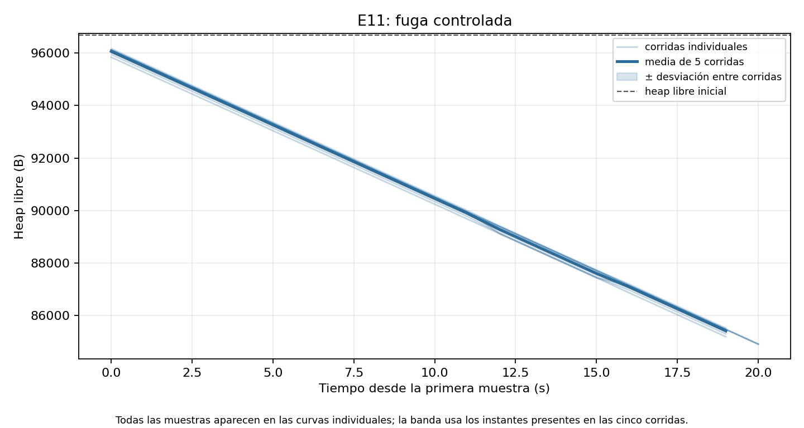
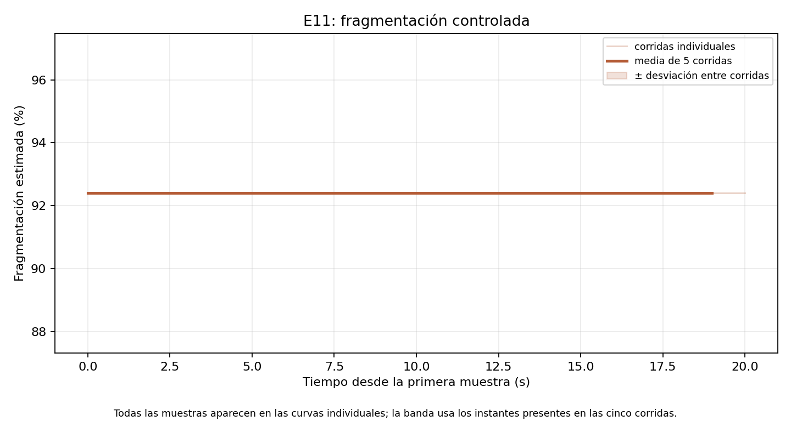

# Sentinel OS: diseño de un sistema operativo bare-metal observable y evaluación experimental en ESP32

**Autor:** Iker · **Asignatura:** Sistemas Operativos, Universidad Pontificia Bolivariana · **Versión editable:** 21 de octubre de 2026

> Formato de entrega provisional. Existe una rúbrica formal de nueve criterios y video de hasta diez minutos en `09-RUBRICA-PROFESOR.md`, pero no consta plantilla ni norma de formato para el informe; P8 continúa abierta. Este Markdown conserva texto, tablas, figuras y referencias editables para adaptarlos al formato que confirme el profesor. No afirma aprobación institucional ni cumplimiento de los nueve criterios.

## Resumen

Sentinel OS implementa un sistema operativo mínimo sobre ESP32-WROOM-32 para estudiar la observabilidad de un kernel desde el propio kernel. El sistema arranca sin FreeRTOS, planifica tareas, gestiona memoria y mutexes, ofrece un sistema de archivos en RAM y ejecuta un shell. Una capa de instrumentación toma marcas de tiempo del contador `CCOUNT`, almacena eventos en un buffer circular y los transmite por UART a un puente en PC. Un detector inspecciona el grafo de espera para hallar ciclos de deadlock.

La evaluación E11 conservó las capturas UART y los CSV de cada ensayo, repitió las baterías comparables al menos cinco veces y comparó compilaciones TRACE ON y OFF bajo la misma carga nominal. La latencia de cambio de contexto **observada con TRACE ON** fue 22,355 ± 0,223 µs como media de cinco corridas y 57 940 cambios completos. La meta de menos de 10 µs **no se cumplió**. La instrumentación consumió +1,285 ± 0,009 puntos porcentuales de CPU bajo la carga nominal y cumplió la meta de menos de 5 puntos. El detector señaló 20 de 20 deadlocks inyectados, con demora media de 320,862 ± 158,026 ms; durante una hora nominal se observaron cero falsas alertas. El resultado demuestra funciones concretas y cuantifica su coste, con dos límites relevantes: la medición altera el cambio que observa y no se dispuso de analizador lógico u osciloscopio para contrastar `CCOUNT` con un pulso GPIO. Los errores UART observados en el PC también impiden equiparar ausencia de eventos recibidos con recepción perfecta.

**Palabras clave:** sistemas operativos, ESP32, planificación, instrumentación, deadlock, efecto observador, UART.

## 1. Introducción y motivación

Un planificador puede parecer correcto mientras oculta pausas largas, bloqueos o pérdida de eventos. Si solo se observa la salida del shell, es difícil distinguir una tarea que espera legítimamente de un ciclo de espera que nunca se resolverá. Sentinel OS explora cómo hacer visible ese estado interno y cuánto cuesta hacerlo. La pregunta central es: **¿qué comportamiento y qué coste puede medirse desde un kernel pequeño sin convertir la propia sonda en una explicación engañosa del resultado?**

La historia de la ingeniería ofrece motivos para observar concurrencia y fallos con cuidado. El incidente de inversión de prioridades de Mars Pathfinder se usa aquí como ejemplo de cómo la interacción entre tareas de distintas prioridades puede producir pausas inesperadas; no se afirma que Sentinel reproduzca exactamente aquel incidente. Los accidentes de Therac-25 muestran por qué el comportamiento concurrente y los mecanismos de seguridad necesitan evidencia y análisis explícitos, no solo una interfaz que parezca funcionar [1, 2]. Sentinel es un proyecto educativo, no un sistema de seguridad crítica.

Un requisito inicial del profesor fue verbal: un sistema operativo minimalista capaz de ejecutar comandos como `ls`, `cd` y `pwd`. Después llegó una [rúbrica formal](../09-RUBRICA-PROFESOR.md) de nueve criterios con `./minios`, bridge, dashboard, Gantt, `slice`, `kill`, `stats` y `exit`, más un video de hasta diez minutos y capturas. E20–E23 planifican lo que falta; el presente informe de E12 no convierte esas funciones futuras en resultados. No consta aún un formato obligatorio del informe. Los requisitos derivados y su grado de confianza se mantienen en [`08-REQUISITOS-PROFESOR.md`](../08-REQUISITOS-PROFESOR.md). La instrumentación y la detección son la tesis adicional del proyecto, no un requisito oficial atribuido al profesor.

## 2. Marco teórico

### 2.1 Planificación y cambio de contexto

Cada tarea tiene un estado y un contexto de CPU. El planificador de Sentinel usa prioridades estáticas y reparto round robin entre tareas del mismo nivel. Un cambio de contexto guarda el estado de la tarea saliente, escoge la siguiente y restaura su estado. En Xtensa LX6 las ventanas de registros complican esta secuencia: un *window spill* debe volcar registros a la pila adecuada antes de devolver el control. Una medición de esta ruta puede incluir trabajo de interrupción, elección y sondas; por eso el informe distingue `switch observado` de una supuesta duración física exacta del cambio desnudo. La decisión de política está documentada en ADR-010.

### 2.2 Memoria y sistema de archivos

El heap usa metadatos por bloque, canarios para detectar corrupción y métricas de espacio libre, mayor hueco y fragmentación. Un canario revela escrituras fuera de la región esperada; no reemplaza protección de memoria. El ESP32 usado carece de una MMU que proporcione paginación y espacios de direcciones separados. RAMFS ofrece rutas y comandos Unix básicos, pero pierde su contenido al reiniciar. La persistencia en flash pertenece al trabajo futuro E19.

### 2.3 Sincronización y deadlock

Un mutex protege una sección crítica. Si A espera un mutex de B y B espera otro de A, el grafo de espera contiene el ciclo A → B → A. El detector construye ese grafo y busca ciclos mediante DFS. Para no participar en el deadlock, el detector no toma mutexes (ADR-007). Esta decisión reduce un tipo de dependencia, pero no prueba que sea inmune a todo fallo del kernel. Tampoco hay herencia de prioridad; una tarea de baja prioridad que retenga un mutex puede perjudicar a otra de prioridad alta.

### 2.4 Trazas y efecto observador

La instrumentación produce eventos de 16 bytes con tiempo, tipo y argumentos. Un productor los escribe en un buffer circular y un consumidor los envía como tramas con secuencia y CRC. Si se llena el buffer, se cuenta el descarte; si Windows pierde o corrompe una trama, sus contadores CRC y de huecos muestran otro punto de pérdida. **Cero descartes en la placa no significa cero errores en el enlace.** Activar la traza agrega instrucciones, memoria y transporte. Comparar TRACE ON y OFF bajo una carga equivalente estima ese efecto integral; medir una sonda aislada responde otra pregunta.

## 3. Estado del arte y posición de Sentinel

`ftrace` en Linux ofrece trazas de funciones, eventos y latencias dentro de un kernel general [3]. `eBPF` permite adjuntar programas verificados a subsistemas de Linux, incluso trazas, sin modificar el código fuente del kernel [4]. Tracealyzer ofrece visualizaciones y análisis de eventos en sistemas embebidos con RTOS [5]; SystemView combina código de adquisición en el objetivo con análisis temporal en PC [6]. Esas herramientas tienen una madurez y un alcance que Sentinel no pretende igualar. La aportación de este proyecto es tener control completo sobre un kernel didáctico pequeño y medir el coste de su propia observación con una comparación ON/OFF, además de conservar los bytes UART y los fallos de meta. No se realizó un benchmark comparativo de rendimiento contra esas herramientas.

## 4. Arquitectura y decisiones

```text
ESP32 core 0
 ├─ shell → planificador → tareas, mutexes, heap, VFS y RAMFS
 ├─ detector de ciclos y heartbeat periódico
 └─ sondas CCOUNT → buffer circular → tramas UART con CRC y secuencia
                                      ↓
PC Windows                         puente Python
                                      ├─ consola / SQLite
                                      └─ UART crudo → CSV → análisis E11
```

El kernel, el detector y el emisor comparten core 0 en la configuración medida. El segundo núcleo está reservado para una propuesta futura AMP (E13), no se cuenta como logro experimental. UART evita introducir WiFi y su pila de red en el kernel. El puente del PC puede usar otros servicios fuera del dispositivo, pero E11 mide la conexión local por UART. ADR-003, ADR-004, ADR-005, ADR-006, ADR-007, ADR-008, ADR-009 y ADR-010 recogen los motivos y consecuencias de estas elecciones. La [arquitectura](../01-ARQUITECTURA.md) y el [protocolo v1](../03-PROTOCOLO.md) contienen la especificación detallada.

## 5. Implementación

El arranque configura vectores y temporizador. El planificador mantiene los estados de las tareas y realiza cambios de contexto sobre la arquitectura Xtensa; el manejo correcto de las ventanas de registros y de la pila fue una dificultad real de implementación. El heap mantiene su arena en SRAM1 (ADR-017) y expone métricas al shell. RAMFS da una jerarquía con rutas que permiten `ls`, `cd` y `pwd`. El shell corre como tarea del sistema y también ofrece `ps`, `free`, `graph`, `detector` e `inject`.

La inyección de deadlock crea dos tareas y dos mutexes con dependencias cruzadas. El detector informa el ciclo y el shell permite detenerlo y limpiar las tareas. Las sondas de traza se excluyen por compilación con `TRACE=0`; con `TRACE=1`, los eventos pasan por un buffer acotado. La trama UART contiene sincronización, versión, tipo, secuencia, longitud, carga y CRC16. El puente [`tools/bridge.py`](../../tools/bridge.py) puede leer el puerto, guardar bytes o reproducir un UART crudo con `--replay`. Esta reproducción es una evidencia repetible; no equivale a una nueva ejecución de la placa.

## 6. Metodología experimental

### 6.1 Entorno, procedencia y criterios

El dispositivo es una placa ESP32-WROOM-32 ejecutando el kernel a 40 MHz según ADR-012. Los scripts y los archivos de la campaña están en [`experiments/e11`](../../experiments/e11/README.md). Cada registro identifica variante, perfil, fecha y commit; las muestras sin pareja y los errores de enlace no se completaron artificialmente. [`master_results.csv`](../../experiments/e11/master_results.csv) reúne 24 métricas con condición, meta, incertidumbre, fuente y limitación. La auditoría [`audit_e11.json`](../../experiments/e11/audit_e11.json) verificó 115 archivos de evidencia versionados. El estado de las seis historias y los criterios fallidos permanece en [`E11-validacion.md`](../tasks/E11-validacion.md).

En una comparación, **la condición debe mantenerse**: la estimación central de CPU usa cinco corridas de 60 s con TRACE ON y cinco con TRACE OFF bajo `inject load nominal`. La batería de switches nominales con TRACE ON tiene cinco corridas de 30 s y 57 940 parejas. `switchbench` es una carga complementaria para observar razones de cambio ausentes de la carga nominal; sus 12 107 parejas no se mezclaron con las 57 940. El detector se probó con 20 inyecciones. Las falsas alertas se contaron durante una hora continua, que no se presenta como cinco horas independientes.

### 6.2 Estadística e incertidumbre

Para una magnitud por corrida se reporta la media de las corridas y `±` una desviación estándar entre ellas, salvo nota en la tabla maestra. Para la distribución de switches se incluyen mínimo, máximo, mediana, desviación muestral de eventos, p95 y p99. Los 301 switches nominales ≥80 µs permanecen en el conjunto. La tasa 20/20 tiene un intervalo binomial aproximado de 95% de 83,2–100% según el análisis E11: **20 éxitos observados no demuestran eficacia universal de 100%**. Los deltas de RAM y binario son diferencias aritméticas de una imagen por variante; no se conoce variación entre recompilaciones. Cero falsas alertas en una hora es el conteo de esa ventana, no una tasa de largo plazo con límite estadístico preciso.

### 6.3 Validación y límites del instrumento

Se reprodujeron los UART crudos para contrastarlos con los CSV. En la hora nominal el dispositivo informó cero descartes y el PC registró 14 errores CRC y 901 huecos. Los controles internos del detector, leídos durante la hora, terminaron con 7228 chequeos y cero alertas; la captura recibida también tiene cero alertas, pero la pérdida del enlace limita lo que este último hecho por sí solo podría probar. Sin analizador lógico u osciloscopio, cinco ventanas de `switchbench` compararon la escala de CCOUNT con un cronómetro de Windows. El cociente de tiempo de Windows incluye ejecución de tareas, esperas y comunicación, por lo que **no** mide el pulso GPIO ni verifica una discrepancia menor de 5%.

## 7. Resultados

| Métrica | Condición | Resultado | Meta / lectura |
|---|---|---:|---|
| Cambio observado | Nominal, TRACE ON; 57 940 parejas | 22,355 ± 0,223 µs | <10 µs: **no cumple** |
| Mediana / p95 / p99 | Mismas parejas | 15,925 / 37,875 / 42,425 µs | Describe la cola de la distribución |
| Coste CPU de TRACE | Nominal, 5 ON + 5 OFF, 60 s | +1,285 ± 0,009 puntos % | <5: cumple |
| Coste integral por evento | Nominal, ON−OFF | 109,111 ± 0,849 ciclos | Incluye drenaje; no comparar con sonda E07 de 48 ciclos |
| RAM / binario extra | Una imagen ON y una OFF | +33 320 B / +3296 B | Sin dispersión entre builds |
| Deadlock detectado | 20 inyecciones de dos tareas | 20/20; 320,862 ± 158,026 ms | 100% y <1 s en casos probados |
| Falsas alertas | Una hora nominal continua | 0 en 3608,872 s y 7228 chequeos | Cumple en esa hora |
| Eventos de placa descartados | Nominal / heavy, 5 × 10 s | 0 de 49 314 / 0 de 108 810 | Nominal <1%: cumple |
| Ocupación UART observada | Nominal / heavy | 20,53 ± 0,20% / 44,09 ± 0,49% | Cota inferior si hubo pérdida de bytes |
| GPIO frente a CCOUNT | Sin instrumento | No medido | <5%: no comprobable |


*Figura 1. Distribución observada con TRACE ON; los valores atípicos se conservaron. Fuente: UART y CSV de E11.*


*Figura 2. Comparación de dos variantes bajo la misma carga nominal. Fuente: batería ON/OFF de E11.*



*Figura 3. Evolución del heap en la inyección de fuga y limpieza posterior. Fuente: batería de memoria de E11.*



*Figura 4. Fragmentación controlada; no representa desgaste o persistencia de flash. Fuente: batería de memoria de E11.*

## 8. Discusión

La meta S1 falló incluso sin atribuir la diferencia únicamente a TRACE. En la comparación nominal de 60 s el switch observado fue 22,6419 ± 0,0002 µs con TRACE OFF y 27,5885 ± 0,0002 µs con TRACE ON. La sonda de medida sigue presente en el camino observado y el método excluye las últimas instrucciones del retorno de interrupción; los dos valores no son una medida desnuda del cambio completo. La distribución nominal con TRACE ON fue bimodal por razón: bloqueo promedió 14,668 µs y apropiación de CPU 36,374 µs. Los 301 valores ≥80 µs corresponden a apropiaciones hacia la tarea detector y aparecen aproximadamente cada 500 ms. Esa coincidencia es consistente con su trabajo periódico, pero no separa el coste de cada instrucción del ISR.

La meta S2 sí se cumplió en la carga nominal: +1,285 puntos porcentuales es el coste medido del sistema de traza en esa condición, no una garantía para todas las cargas. El valor de 109,111 ciclos por evento incluye consumo y drenaje; los 48 ciclos de E07 medían la sonda aislada. La diferencia enseña por qué dos números con la misma unidad pueden representar fronteras experimentales distintas. En `heavy` no hubo descartes reportados por la placa, así que no debe describirse como saturación demostrada. Los huecos y CRC del PC señalan que la integridad de recepción es un problema separado del buffer de traza en el dispositivo.

Las 20 detecciones y la hora sin falsas alertas son evidencia fuerte dentro de los escenarios elegidos. No cubren todos los posibles grafos de espera ni fallos del detector. La reproducción de trazas ofrece un plan B fiable para explicar el caso registrado, pero no sustituye una nueva prueba en placa. La mayor conclusión metodológica es que el sistema puede medir su propio coste, siempre que reporte con precisión la condición, el punto de medida y lo que queda fuera.

## 9. Limitaciones y amenazas a la validez

1. **Instrumentación intrusiva:** `CCOUNT` y los eventos añaden trabajo; no hay una medida totalmente externa del camino completo.
2. **Sin validación GPIO instrumental:** el cronómetro de Windows solo compara orden de magnitud. El criterio de discrepancia <5% permanece no comprobable.
3. **Recepción UART imperfecta:** 14 CRC y 901 huecos en la hora nominal. El cero del detector se apoya también en contadores internos, pero los bytes recibidos no forman una transcripción perfecta.
4. **Alcance de las muestras:** la carga nominal y `switchbench` no son intercambiables. La incertidumbre entre cinco corridas no captura todas las variaciones térmicas, de energía o de hardware.
5. **Arquitectura funcional:** no hay MMU, aislamiento de procesos, persistencia RAMFS ni herencia de prioridad. Core 1 no ejecuta un observador en la versión medida.
6. **Entrega académica:** la rúbrica formal existe, pero todavía faltan varios criterios C2–C9, el video evaluado, las capturas y la portada. No se confirmó un formato obligatorio para este informe. Este documento no afirma validación por el profesor.

## 10. Trabajo futuro

E13 propone mover el consumidor de traza al segundo núcleo y repetir la comparación de overhead para separar contención de memoria y trabajo de CPU. E14 y E16 prevén exportación y visualización; E15, análisis predictivo; E17, calidad y CI; E18, políticas de planificación; E19, persistencia. Ninguna figura o cifra de este informe se atribuye a esas etapas. Antes de optimizar S1 conviene medir externamente el límite del cambio con instrumentación GPIO adecuada y desglosar interrupción, planificación, guardado y restauración de registros.

## 11. Conclusiones

Sentinel OS ejecuta funciones básicas de un sistema operativo y produce evidencia reproducible de su comportamiento interno. Su instrumentación nominal consume +1,285 ± 0,009 puntos de CPU y las 20 inyecciones de deadlock fueron detectadas, pero la latencia media observada de 22,355 ± 0,223 µs incumple la meta de 10 µs. El proyecto permite discutir el efecto observador con datos reales, conservar resultados adversos y distinguir una medición de placa, un cálculo del PC y una hipótesis causal. El siguiente resultado experimental decisivo sería una validación externa del cambio de contexto con instrumento apropiado.

## Bibliografía

1. NASA, *Software Construction and Analysis Tools for Future Missions*; referencia histórica a inversión de prioridad en Mars Pathfinder. [NASA NTRS](https://ntrs.nasa.gov/api/citations/20020063476/downloads/20020063476.pdf?attachment=true).
2. N. Leveson y C. S. Turner, “An Investigation of the Therac-25 Accidents”, *IEEE Computer* 26(7), 1993, pp. 18–41. [Texto de los autores alojado por MIT](https://web.mit.edu/6.033/2004/wwwdocs/papers/Therac_1.html).
3. S. Rostedt y colaboradores, “ftrace — Function Tracer”, documentación del kernel Linux. [Kernel.org](https://www.kernel.org/doc/html/latest/trace/ftrace.html).
4. Linux kernel documentation, “eBPF Userspace API”. [Kernel.org](https://kernel.org/doc/html/latest/userspace-api/ebpf/index.html).
5. Percepio, “Tracealyzer Features and Capabilities”. [Percepio](https://percepio.com/tracealyzer/features-capabilities/).
6. SEGGER, *SystemView User Guide*, versión 4.10. [SEGGER](https://doc.segger.com/UM08027_SystemView.html).
7. Sentinel OS, [`experiments/e11/master_results.csv`](../../experiments/e11/master_results.csv), métodos y UART crudos versionados, 2026. Datos primarios de este informe.
